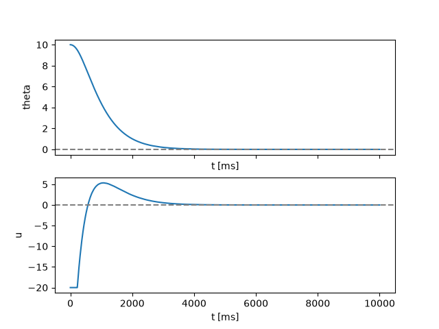

# PWr_in_Space_ASC

Solution for the theoretical and software task from the second stage of recruitment for the ACS department of the PWr in Space project. It contains a PID controller simulation aimed at stabilizing a rocket in a vertical position.

## Setup (Ubuntu)

Clone the repository:

```bash
git clone https://github.com/spac3tr1p/PWr_in_Space_ASC
cd PWr_in_Space_ASC
```

Install dependencies and build executable program (requires uv and cmake):

```bash
cmake -S . -B build 
cmake --build build
uv sync
```

## Run
Run this command to generate `data.csv` file:
```bash
./build/PWr_in_Space_ASC
```
Run this command to generate `chart.png` file:

```bash
uv run chart.py
```
File `chart.png` should be created.

Modifying `KP`, `KI`, `KD` in **pid.c** will change the output and the chart itself.

```c
// pid.c
#define KP 4.0f
#define KI 0.0f
#define KD 4.0f
```

